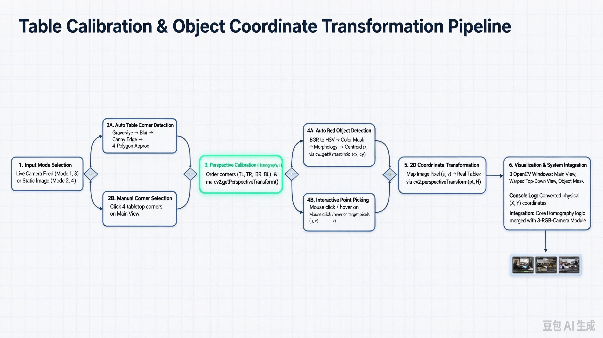

> OpenCV-based vision calibration and coordinate transformation prototype: maps 2D camera image pixels to real-world 2D tabletop coordinates via a four-corner homography.

## Overview

This script implements an OpenCV-based vision calibration and coordinate transformation prototype that maps 2D camera image pixels to real-world 2D tabletop coordinates. Supporting both live camera feeds and static images, the program identifies the four corners of a rectangular table either automatically (via Canny edge detection and contour approximation) or through manual mouse clicks, and then computes a Homography matrix (perspective transformation) based on user-defined physical table dimensions. Once calibrated, it automatically detects target objects (using HSV color segmentation and contour moments) or accepts manually clicked points, converting their pixel coordinates into physical tabletop (X, Y) coordinates. As its output, the program prints the converted real-world coordinates to the console and displays three real-time OpenCV visualization windows: the Main View (showing detected corners, contours, and coordinate overlays), the Warped Top-Down View (a bird's-eye perspective-corrected view of the table), and the binary Object Mask.



## Features

- **Input source**: live camera feed or a static image.
- **Table corner calibration**: automatic (Canny edges + contour approximation) or manual 4-point mouse click.
- **Homography / perspective transform** built from user-defined physical table dimensions.
- **Object detection**: automatic HSV color segmentation with contour moments, or manually clicked points.
- **Pixel → real coordinate conversion** to physical tabletop (X, Y) coordinates.
- **Three real-time OpenCV windows**: Main View, Warped Top-Down View, and binary Object Mask.
- Converted real-world coordinates are printed to the console.

## Requirements

- Python 3
- `opencv-python`
- `numpy`

Install dependencies:

```bash
pip install opencv-python numpy
```

## Usage

Run the main script (the filename contains parentheses, so wrap it in quotes):

```bash
python "3D2D(Final Code).py"
```

Then choose an input mode:

| Mode | Description |
|------|-------------|
| 1 | Camera + automatic table detection |
| 2 | Image + automatic table detection |
| 3 | Camera + manual corner selection |
| 4 | Image + manual corner selection |

### Keyboard Controls (main window)

| Key | Action |
|-----|--------|
| `q` | Quit |
| `f` | Freeze / unfreeze the current camera frame |
| `a` | Auto-detect table corners |
| `c` | Clear all corners and points |
| `r` | Clear clicked object points only |
| `m` | Re-select corners manually |
| `t` | Enter the real table width / height |
| `p` | Print all clicked points in real coordinates |
| `s` | Save main / warped / mask images |

## How It Works

1. Detect or select the 4 table corners, then order them as top-left, top-right, bottom-right, bottom-left.
2. `cv2.getPerspectiveTransform` builds the homography from the image corners to the real table rectangle.
3. `cv2.perspectiveTransform` maps image points into real table coordinates, scaled by the known physical width / height.
4. `cv2.warpPerspective` renders the corrected top-down view.

## Note on System Integration

The core homography mapping logic in this standalone prototype has since been merged with the 3-RGB-camera multi-view perception subsystem; therefore, the current integrated system pipeline utilizes only the core coordinate transformation components rather than executing this standalone script in its entirety.

## Repository Contents

- **`3D2D(Final Code).py`** — main standalone prototype script.
- **`Workflow.jpeg`** — system workflow diagram.
- **`Table Images.zip`** — sample tabletop images used for testing.
- **`iterate code.zip`** — archived iteration versions of the code.
